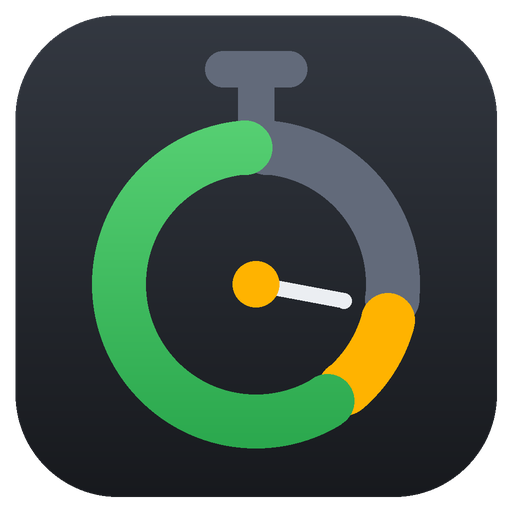

<p align="center"></p>

<h1 align="center">LiveCount</h1>

<p align="center">Timer countdown per eventi dal vivo: regia sul monitor principale, display a schermo pieno sul secondo schermo.</p>

<p align="center">
  <a href="https://github.com/ncrdavide-svg/LiveCount/releases/latest/download/LiveCount.exe">
    
  </a>
</p>

<p align="center">
  <br>
  Il pulsante scarica direttamente <code>LiveCount.exe</code> · <a href="https://github.com/ncrdavide-svg/LiveCount/releases">tutte le versioni e le novità</a>
</p>

Nessuna installazione: scarichi `LiveCount.exe`, doppio clic e parte. Funziona su Windows 10 e 11 a 64 bit.

Preferisci installarlo come gli altri programmi? Scarica **[LiveCount-Setup.exe](https://github.com/ncrdavide-svg/LiveCount/releases/latest/download/LiveCount-Setup.exe)**: aggiunge LiveCount al menu Start (e, se vuoi, al desktop) e si disinstalla da *Impostazioni → App → App installate*. Puoi installarlo per tutti gli utenti o solo per te (senza permessi di amministratore).

> Al primo avvio Windows potrebbe mostrare "Windows ha protetto il PC" (l'exe non è firmato): clicca **Ulteriori informazioni → Esegui comunque**.

> **Suite LIVE** · Con **[LiveSuite](https://github.com/ncrdavide-svg/LiveSuite)** installi e tieni aggiornate LiveCue, LiveDeck, LiveCount e LiveCaption da un'unica piccola app (nessuna installazione): **[scarica LiveSuite.exe](https://github.com/ncrdavide-svg/LiveSuite/releases/latest/download/LiveSuite.exe)**.

## Funzioni

- **Countdown con barra di avanzamento** che cambia colore: verde, arancio sotto il 10% del tempo, rosso sotto il 5% (soglie e colori personalizzabili).
- **Conteggio extra** dopo lo zero (`+00:01`, `+00:02`…), sempre in rosso.
- **Preset** con nome e durata, più impostazione manuale di ore, minuti e secondi.
- **Velocità di scorrimento** regolabile da 0.5x a 2x a passi di 0.1 (1x = tempo reale), anche mentre il timer corre.
- **Messaggio sotto il timer**, da mostrare o nascondere con un clic (F9), con font, colore e grandezza a scelta.
- **Video di sfondo** da una sorgente **NDI®** o da una **scheda di acquisizione USB** (Magewell USB Capture, AJA U-TAP, webcam…), con il timer in un riquadro sovrapposto. Le impostazioni del video si aprono con il pulsante **Avanzate** nella regia.
- **Monitor dal vivo** dello schermo secondario nella regia: trascini il riquadro del timer per spostarlo, l'angolo per ridimensionarlo, la rotellina per ingrandirlo.
- Font, dimensioni e colori di timer, sfondo, messaggio e riquadro tutti configurabili.
- **Eventi salvati**: menu **File → Salva evento / Apri evento** (Ctrl+S / Ctrl+O) per salvare in un file `.livecount` timer, preset, aspetto, messaggio e video di un evento e ricaricarlo quando serve, anche su un altro PC (monitor e porta restano quelli del PC che lo apre).

## Stream Deck con Bitfocus Companion

LiveCount si comanda dalla rete, quindi anche da uno Stream Deck tramite [Bitfocus Companion](https://bitfocus.io/companion).

1. In LiveCount, nel riquadro **Companion / Stream Deck**, scegli il tuo deck (15 o 32 tasti) e premi **Esporta per Companion...**
2. Indica se Companion gira sullo stesso PC o su un altro, e salva `LiveCount.companionconfig`.
3. In Companion: **Import / Export → Import**, scegli il file e importa la pagina "LiveCount" su una pagina vuota.

Tasti generati: **AVVIA**, **PAUSA**, **RESET**, **+1 / +5 / +10 MIN**, **−1 / −5 / −10 MIN** e un tasto per ogni preset (nome e durata). Quando aggiungi o rinomini preset, esporta di nuovo e reimporta.

Serve il modulo **Generic HTTP** di Companion. Se Companion è su un altro PC, consenti LiveCount nel Windows Firewall al primo avvio.

<details>
<summary>API HTTP (per altri sistemi di controllo)</summary>

Porta predefinita `8787`, tutte le richieste in GET, risposta JSON con lo stato del timer.

| Indirizzo | Azione |
|---|---|
| `/api/start` · `/api/pause` · `/api/toggle` · `/api/reset` | Trasporto |
| `/api/add?min=5` (negativo per togliere) | Aggiunge o toglie minuti |
| `/api/preset?name=Nome` · `/api/preset?index=1` | Carica un preset |
| `/api/message/show` · `/hide` · `/toggle` | Messaggio sotto il timer |
| `/api/display/show` · `/hide` | Display sul secondo schermo |
| `/api/speed?value=1.5` · `/api/speed/up` · `/down` · `/reset` | Velocità di scorrimento (0.5–2.0, passi di 0.1) |
| `/api/status` | Stato: `text`, `remaining_ms`, `total_ms`, `running`, `speed`, `phase`, `message_visible` |

</details>

## Scorciatoie

| Tasto | Azione |
|---|---|
| F5 | Avvia / pausa |
| F8 | Reset |
| F9 | Mostra / nascondi messaggio |

## Impostazioni

Preset e preferenze vengono salvati in `LiveCount.settings.xml`, accanto all'exe (oppure in `%APPDATA%\LiveCount` se la cartella non è scrivibile): copiando la cartella su un altro PC ti porti dietro anche la configurazione.

## Compilare dai sorgenti

Serve solo Windows: `build.bat` usa il compilatore C# incluso in .NET Framework 4.
Se sul PC è installato il runtime NDI (es. con NDI Tools), la libreria viene incorporata automaticamente nell'exe.

```bat
build.bat
```

L'icona si rigenera con `python tools/make_icon.py` (richiede Pillow).

L'installer si crea con [Inno Setup 6](https://jrsoftware.org/isinfo.php) (`winget install JRSoftware.InnoSetup`):

```bat
powershell -ExecutionPolicy Bypass -File installer\build-installer.ps1
```

Compila l'exe e mette `LiveCount-Setup-<versione>.exe` e `LiveCount-Setup.exe` nella cartella `dist`.

## Supporta il progetto

Se LiveCount ti è utile, offrimi un caffè: [buymeacoffee.com/cin8](https://buymeacoffee.com/cin8)

---

<sub>NDI® is a registered trademark of Vizrt NDI AB — [ndi.video](https://ndi.video)</sub>
