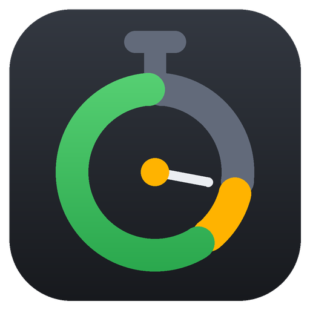

<p align="center"></p>

<h1 align="center">LiveCount</h1>

<p align="center">Timer countdown per eventi dal vivo: regia sul monitor principale, display a schermo pieno sul secondo schermo.</p>

<p align="center"><a href="https://github.com/ncrdavide-svg/LiveCount/releases/latest/download/LiveCount.exe"><b>⬇ Scarica LiveCount.exe</b></a></p>

Nessuna installazione: scarichi `LiveCount.exe`, doppio clic e parte. Funziona su Windows 10 e 11 a 64 bit.

> Al primo avvio Windows potrebbe mostrare "Windows ha protetto il PC" (l'exe non è firmato): clicca **Ulteriori informazioni → Esegui comunque**.

## Funzioni

- **Countdown con barra di avanzamento** che cambia colore: verde, arancio sotto il 10% del tempo, rosso sotto il 5% (soglie e colori personalizzabili).
- **Conteggio extra** dopo lo zero (`+00:01`, `+00:02`…), sempre in rosso.
- **Preset** con nome e durata, più impostazione manuale di ore, minuti e secondi.
- **Messaggio sotto il timer**, da mostrare o nascondere con un clic (F9), con font, colore e grandezza a scelta.
- **Video di sfondo** da una sorgente **NDI®** o da una **scheda di acquisizione USB** (Magewell USB Capture, AJA U-TAP, webcam…), con il timer in un riquadro sovrapposto.
- **Monitor dal vivo** dello schermo secondario nella regia: trascini il riquadro del timer per spostarlo, l'angolo per ridimensionarlo, la rotellina per ingrandirlo.
- Font, dimensioni e colori di timer, sfondo, messaggio e riquadro tutti configurabili.

## Scorciatoie

| Tasto | Azione |
|---|---|
| F5 | Avvia / pausa |
| F8 | Reset |
| F9 | Mostra / nascondi messaggio |

## Impostazioni

Preset e preferenze vengono salvati in `LiveCount.settings.xml`, accanto all'exe (oppure in `%APPDATA%\LiveCount` se la cartella non è scrivibile): copiando la cartella su un altro PC ti porti dietro anche la configurazione.

## Compilare dai sorgenti

Serve solo Windows: `build.bat` usa il compilatore C# incluso in .NET Framework 4.
Se sul PC è installato il runtime NDI (es. con NDI Tools), la libreria viene incorporata automaticamente nell'exe.

```bat
build.bat
```

L'icona si rigenera con `python tools/make_icon.py` (richiede Pillow).

## Supporta il progetto

Se LiveCount ti è utile, offrimi un caffè: [buymeacoffee.com/cin8](https://buymeacoffee.com/cin8)

---

<sub>NDI® is a registered trademark of Vizrt NDI AB — [ndi.video](https://ndi.video)</sub>
